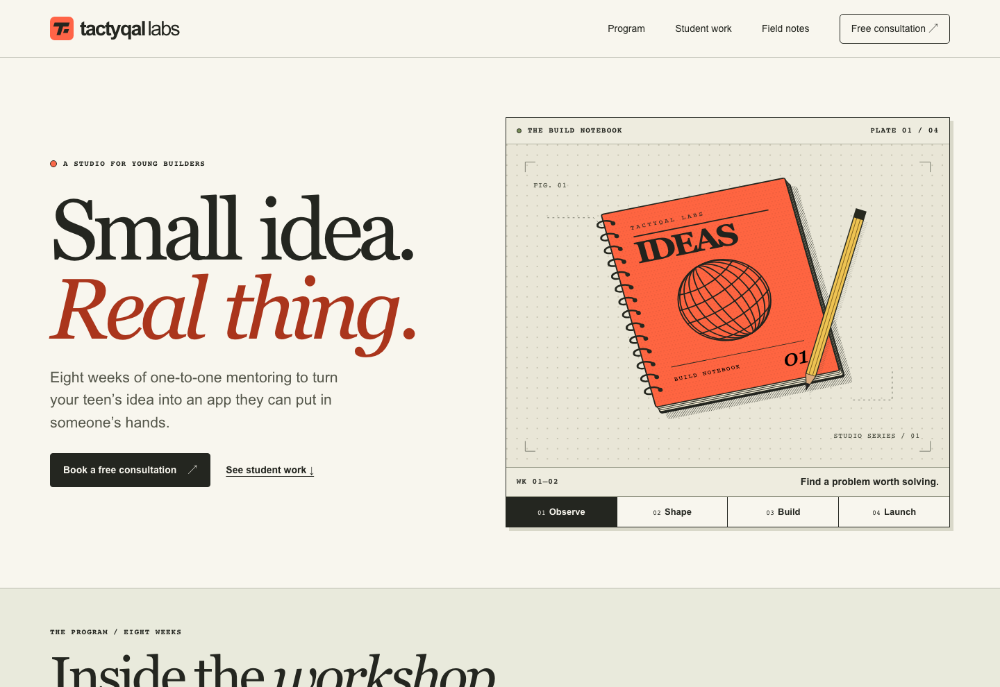

# Tactyqal Labs · The Build Notebook

A full-stack hiring challenge by Meghna Nair. An illustrated, four-stage notebook introduces the mentoring program. The student-project index, public journal and protected editorial desk share one responsive interface.

[Live project](https://tactyqal-notebook.heymegzz.workers.dev) · [Recorded walkthrough](docs/walkthrough.webm) · [Walkthrough script](docs/walkthrough.md) · [API contract](docs/api.md) · [WordPress transition](docs/migration.md)



## Run locally

Use Node 22.13 or newer and npm. These commands start a local database and Worker. Run them from the repository root.

```sh
npm ci
node -e "require('fs').writeFileSync('.dev.vars','ADMIN_KEY='+require('crypto').randomBytes(32).toString('hex')+'\n',{flag:'wx',mode:0o600})"
npm run build
npm run db:migrate
npm start
```

Open the loopback URL printed by Wrangler. Visit `/admin` and enter the key from your local `.dev.vars`. Keep this file private. Subsequent starts reuse the same data. The key generation command refuses to overwrite an existing file. The local migration runner records applied migrations and is safe to run again. Rebuild after source changes before testing with `npm start`.

| Setting | Purpose |
| --- | --- |
| `ADMIN_KEY` | Random editor secret, minimum 32 characters. Configure in the host's secret settings for production. A missing or short secret disables login. Rotation invalidates existing sessions. |
| `DB` | Cloudflare D1 binding. Configured by the hosting manifest and emulated locally with Wrangler. |
| `LOCAL_DB_DIR` | Optional emulator persistence directory, default `.wrangler/notebook`. Use the same value for migrate and serve. |
| `TEST_ORIGIN` | Optional API test target, default `http://127.0.0.1:8787`. The checks accept loopback targets only. |

## Structure

- `app/`, `components/` — React/TypeScript App Router pages compiled with Vinext. Article pages render on the server. Interactive notebook, search, filters, pagination and editor run in the browser.
- `src/api.ts`, `src/posts.ts` — shared HTTP handlers, validated payloads, parameterized SQL, pagination and consistent JSON errors. The database owns the unique slug constraint. Updates and deletes require the last seen version.
- `src/editor-auth.ts` — one-hour signed, HTTP-only, same-site editor sessions. HTTPS sets Secure cookies. Mutation handlers independently enforce access and reject cross-origin browser writes.
- `db/schema.ts`, `drizzle/` — typed schema, versioned SQL and migration metadata. Posts store content and metadata together. Category and bounded tag lists are deliberately simple for this single-publication edition.
- `src/seeds.ts` — three original example exercises for the challenge journal. A transaction and a durable marker seed them once on first journal access. Deleting a seed article does not resurrect it.
- `public/art/` — four original, lightweight vector illustrations. Pages support keyboard navigation, reduced motion and system fonts. Covers accept a studio illustration or an HTTPS URL. Article bodies render as escaped plain text.

## Verify

```sh
npm run typecheck
npm run build
npm run db:migrate
# In another terminal while npm start is running:
npm run test:api
```

The integration test creates and deletes its own post. It exercises anonymous write rejection, sign-in, cross-origin rejection, invalid fields and pagination, duplicate slugs, hidden drafts, optimistic concurrency, publication, search, filtering, pagination, unpublishing and deletion. Desktop (1440 px) and mobile (390 px) captures are in `docs/`.

## Deployment

The Worker runs on Cloudflare with a D1 binding named `DB`. Run `npx wrangler login`, create a dedicated database with `npx wrangler d1 create tactyqal-notebook`, and set `D1_DATABASE_ID` to its returned UUID. Then run:

```sh
npm run build
npm run deploy:migrate
npm run deploy:worker
```

The deployment script refuses the local emulator ID. It uses the same built Worker and static assets as local verification. Configure the editor secret with `npm run deploy:secret` and enter a private, randomly generated key at the prompt. The admin login fails closed until this secret is set. Wrangler prints the assigned public URL after deployment.

## Decisions and limits

One editor key keeps this challenge easy to review. A team rollout should use separate staff identities, role assignments and an audit trail. Logout clears the browser cookie; emergency key rotation invalidates all issued cookies. Uploaded media and rich HTML authoring are outside this edition. Covers can reference a managed media host. Search uses bounded substring queries suitable for a small journal; large archives should use full-text indexing.

The homepage draws on Tactyqal’s published eight-week schedule, student examples and consultation calendar. Illustrations interpret the projects. The seed articles are original demonstration content. Production CodeIgniter, WordPress, and the source site’s booking system were never modified.

[Original Tactyqal homepage](https://www.tactyqal.com/) · [Design references and rationale](docs/design.md)
